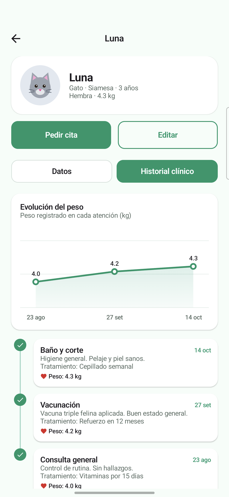
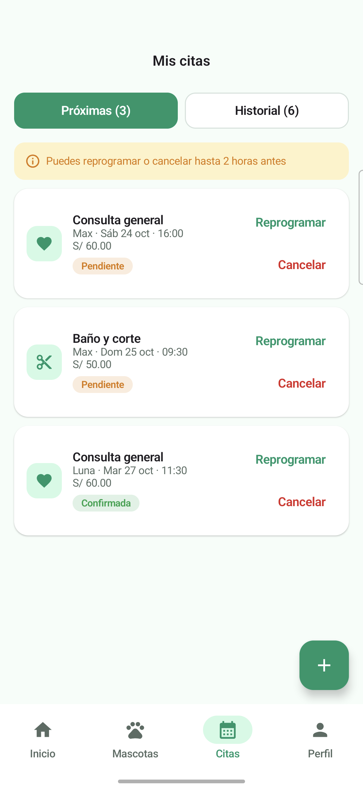
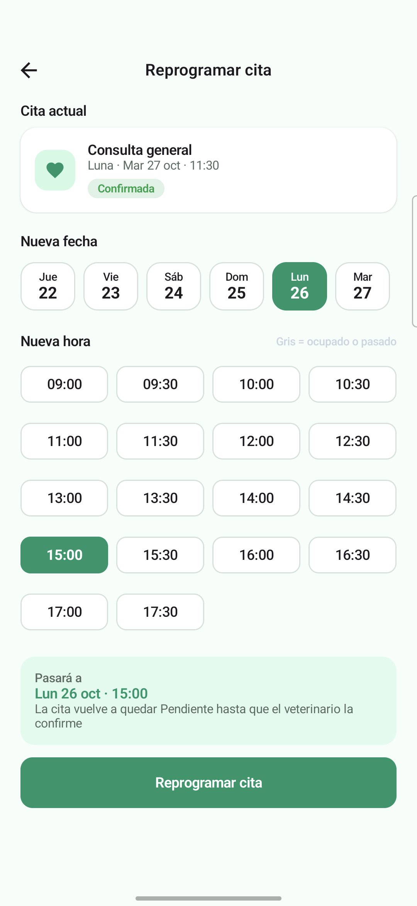
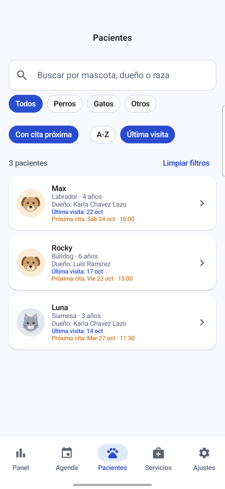

# HuellitasVet LAB 8 - FASE 2

App Android para una veterinaria con dos perfiles en el mismo dispositivo. El Dueño registra a sus mascotas, pide citas eligiendo servicio, fecha y hora, y revisa el historial clínico de cada mascota. El Veterinario ve el panel de la clínica y la agenda, confirma citas, registra la atención (diagnóstico, tratamiento y peso), consulta a los pacientes y administra los servicios. Los dos perfiles comparten la misma base de datos Room: cuando el veterinario registra una atención, el dueño la ve al instante en el historial de su mascota.

| Dato | Detalle |
|---|---|
| Curso | Programación en Móviles |
| Laboratorio | Semana 08 · MVVM + Room |
| Alumno | Karla Chavez Lazo |
| Sección | D |
| Ramas | `CON-IA` (Fase 2) |
| Patrón | MVVM + Repository (interface `VetRepository` con implementación `VetRepositoryRoom`) |


## Estructura de paquetes

```
com.tecsup.huellitasvet
├── MainActivity.kt
├── VetApp.kt                        crea la base, el repository y las preferencias; siembra los datos
├── data
│   ├── local
│   │   ├── entity                   Servicio, Usuario, Mascota, Cita
│   │   ├── dao                      ServicioDao, UsuarioDao, MascotaDao, CitaDao
│   │   ├── relation                 MascotaConDueno, CitaConDetalle
│   │   ├── VetDatabase.kt           singleton de Room (huellitasvet.db)
│   │   └── DatosIniciales.kt        datos ficticios de la primera vez
│   ├── repository
│   │   ├── VetRepository.kt         interface (el contrato)
│   │   └── VetRepositoryRoom.kt     implementación con Room
│   └── prefs
│       └── PreferenciasStore.kt     DataStore
├── model                            Rol, EstadoCita, Especie, Sexo, ConteoServicio, Horarios, PuntoPeso
├── viewmodel                        VetViewModelFactory, Sesion, Inicio, Mascota, PedirCita, MisCitas,
│                                    Panel, Agenda, AtenderCita, Pacientes, Servicios, ReprogramarCita
└── ui
    ├── theme                        Color, Type, Theme (VetTheme por rol y modo oscuro)
    ├── components                   AppTopBar, VetButton, VetTextField, EstadoCitaChip, MascotaAvatar,
    │   │                            CitaCard, FechaChip, HoraChip, HistorialItem, IconoServicio, Formato
    │   └── graficos                 DatoGrafico, GraficoDona, GraficoBarras, GraficoLineas
    ├── navigation                   Rutas, NavVet (grafo del dueño y del veterinario)
    ├── dueno                        Splash, Login, Inicio, Mascotas, FormularioMascota, FichaMascota,
    │                                PedirCita, MisCitas, Perfil, ReprogramarCita
    └── veterinario                  Panel, Agenda, AtenderCita, Pacientes, Servicios,
                                     FormularioServicio, Ajustes
```

## Base de datos

### Modelo conceptual

- Un usuario puede ser Dueño (CLIENTE) o Veterinario (ADMIN).
- Un dueño tiene muchas mascotas; cada mascota pertenece a un solo dueño.
- Una mascota tiene muchas citas; cada cita es de una sola mascota.
- Un servicio aparece en muchas citas; cada cita es de un solo servicio.
- Cuando una cita se atiende, guarda el diagnóstico, el tratamiento y el peso de ese día; con eso se arma el historial clínico.

## Fase 2 · Mejoras con IA

Hechas en la rama `CON-IA` con ayuda de Claude. Los prompts, lo que generó la IA y lo que se corrigió están en [PROMPTS.md](PROMPTS.md).

| Mejora | Qué logra | Capas que cambian |
|---|---|---|
| Gráfico de peso de la mascota | La ficha muestra una línea con el peso registrado en cada atención | DAO + Repository + ViewModel + View |
| Reprogramar cita | El dueño cambia la fecha y la hora de una cita PENDIENTE o CONFIRMADA a un horario libre, hasta 2 horas antes | DAO + Repository + ViewModel + View |
| Búsqueda de pacientes | Busca por mascota, dueño o raza; filtra por especie y por "Con cita próxima"; ordena A-Z o por última visita | ViewModel + View |

| Gráfico de peso | Mis citas con reprogramar | Reprogramar cita | Búsqueda de pacientes |
|---|---|---|---|
|  |  |  |  |

### Cambios en la base de datos

Ninguna mejora cambió ni agregó entidades: no hay columnas nuevas, la base sigue en `version = 1` y no hizo falta una `Migration`. Solo se agregaron consultas al `CitaDao`, declaradas primero en la interface `VetRepository`:

| Función | Tipo | Qué hace |
|---|---|---|
| `observarPesos(mascotaId)` | `Flow<List<PuntoPeso>>` | `SELECT fecha, pesoRegistrado` de las citas ATENDIDAS de la mascota, ordenadas por fecha y hora |
| `reprogramarCita(id, fecha, hora)` | `suspend` | `UPDATE` de fecha y hora; la cita vuelve a PENDIENTE y conserva su precio |

### Reglas nuevas

| Regla | Dónde vive |
|---|---|
| El gráfico de peso aparece con al menos 2 atenciones con peso; con menos se muestra un aviso | `MascotaViewModel.pesos()` y `FichaMascotaScreen` |
| Solo se reprograma una cita PENDIENTE o CONFIRMADA y si faltan más de 2 horas | `ReprogramarCitaViewModel.puedeReprogramar()` y `MisCitasViewModel.puedeReprogramar()` |
| La nueva hora debe estar libre y en el futuro; antes de guardar se vuelve a consultar el horario | `ReprogramarCitaViewModel.confirmar()` |
| Una cita reprogramada vuelve a PENDIENTE para que el veterinario confirme el nuevo horario | `CitaDao.reprogramar()` |
| "Con cita próxima" muestra solo mascotas con una cita PENDIENTE o CONFIRMADA desde ahora | `PacientesViewModel` |
| Al ordenar por última visita, las mascotas sin visitas quedan al final | `PacientesViewModel` |

### Pruebas de la Fase 2

| Prueba | Resultado esperado | Estado |
|---|---|---|
| Ficha de Luna, Historial clínico | Línea con 4.0, 4.2 y 4.3 kg en sus fechas | Cumple |
| Ficha de Rocky (un solo peso) | Aviso de que se necesitan 2 atenciones | Cumple |
| Reprogramar una cita a un horario libre | Cambia fecha y hora, queda PENDIENTE y mantiene el precio | Cumple |
| Reprogramar y elegir un horario ocupado | El horario aparece gris y no se puede elegir | Cumple |
| Reprogramar una cita a menos de 2 horas | No se permite y se muestra un mensaje | Cumple |
| Buscar "bull" en Pacientes | Aparece solo Rocky (raza Bulldog) | Cumple |
| Filtro "Con cita próxima" | Solo las mascotas con una cita próxima | Cumple |
| Ordenar por última visita | La visita más reciente primero y las mascotas sin visitas al final | Cumple |
| Limpiar filtros | Vuelven todos los pacientes | Cumple |

