# HuellitasVet LAB 8

App Android para una veterinaria con dos perfiles en el mismo dispositivo. El Dueño registra a sus mascotas, pide citas eligiendo servicio, fecha y hora, y revisa el historial clínico de cada mascota. El Veterinario ve el panel de la clínica y la agenda, confirma citas, registra la atención (diagnóstico, tratamiento y peso), consulta a los pacientes y administra los servicios. Los dos perfiles comparten la misma base de datos Room: cuando el veterinario registra una atención, el dueño la ve al instante en el historial de su mascota.

| Dato | Detalle |
|---|---|
| Curso | Programación en Móviles  |
| Laboratorio | Semana 08 · MVVM + Room |
| Alumno | Karla Chavez Lazo |
| Sección | D |
| Ramas | `SIN-IA` (Fase 1, sin IA) y `CON-IA` (Fase 2, con IA) |
| Patrón | MVVM + Repository (interface `VetRepository` con implementación `VetRepositoryRoom`) |


## Vistas de la app

Capturas

### Perfil Dueño

| Splash | Inicio de sesión | Inicio | Mis mascotas |
|---|---|---|---|
| 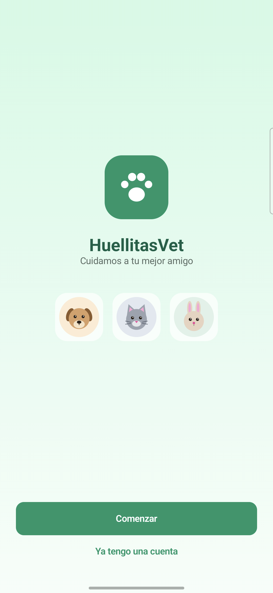 | 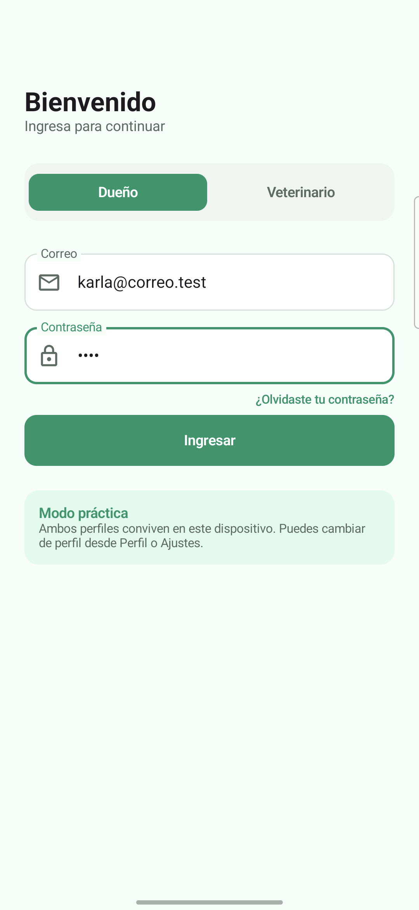 | 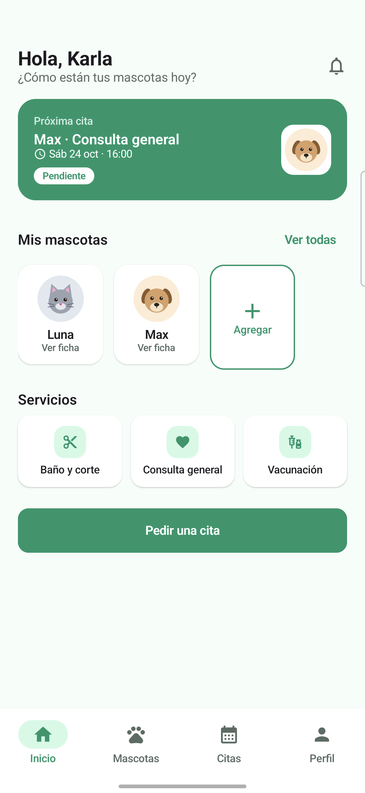 | 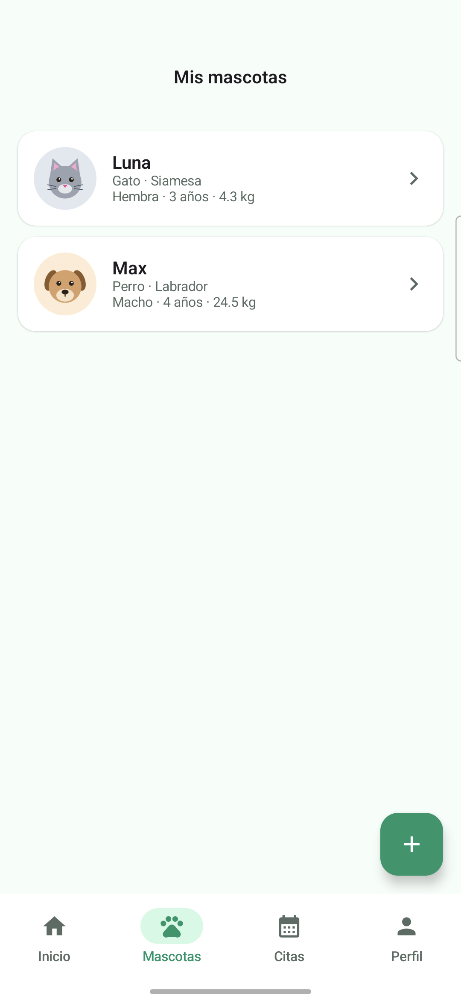 |

| Ficha e historial | Registrar mascota | Pedir cita | Mis citas |
|---|---|---|---|
| 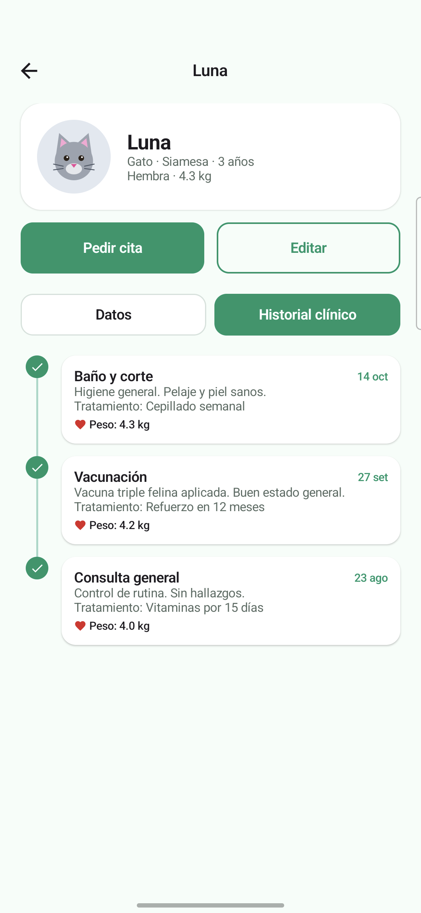 | 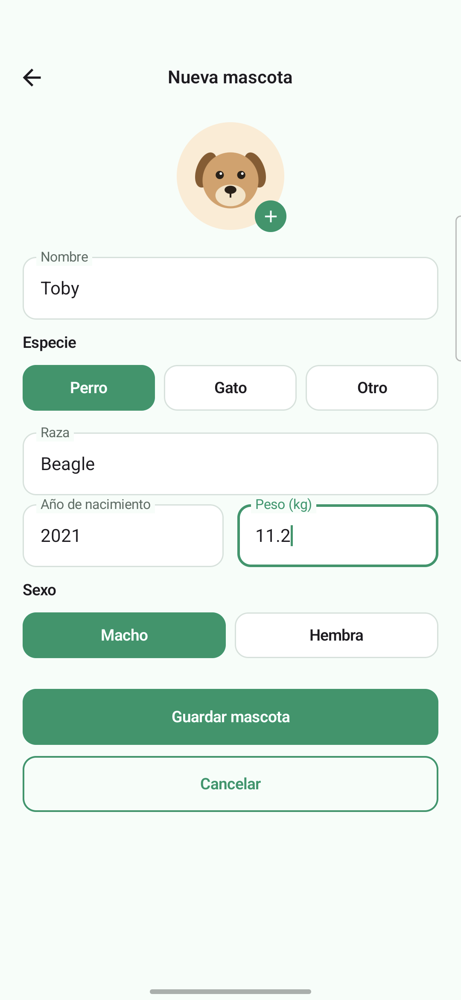 | 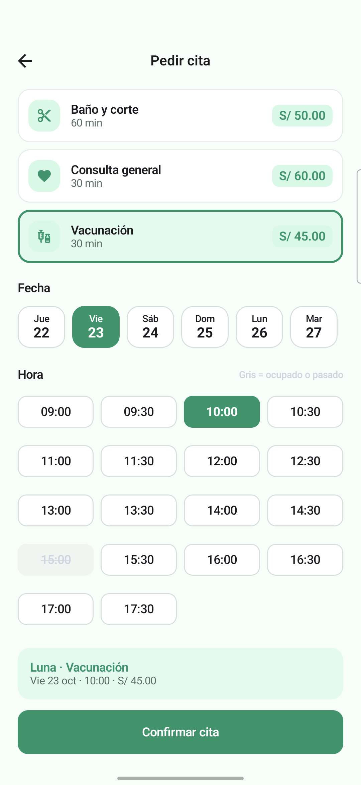 | 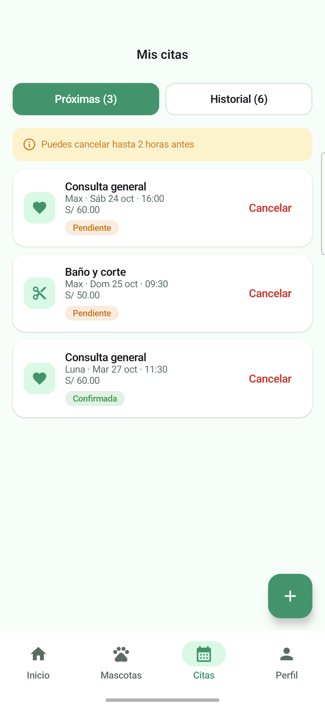 |

| Perfil y preferencias |
|---|
| 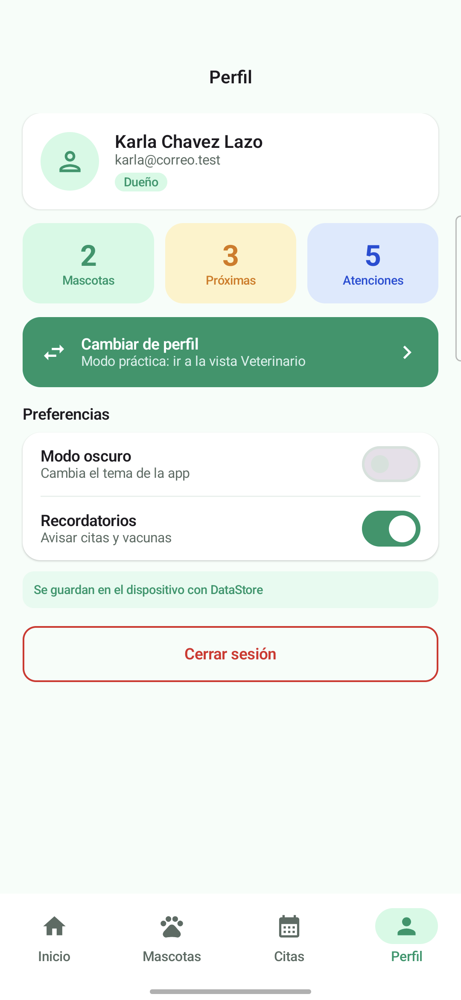 |

### Perfil Veterinario

| Inicio de sesión | Panel de la clínica | Agenda | Atender cita |
|---|---|---|---|
| 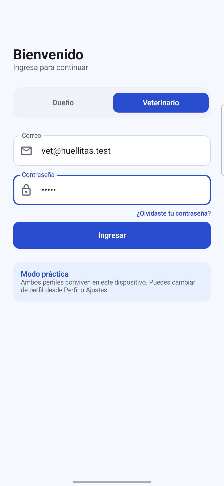 | 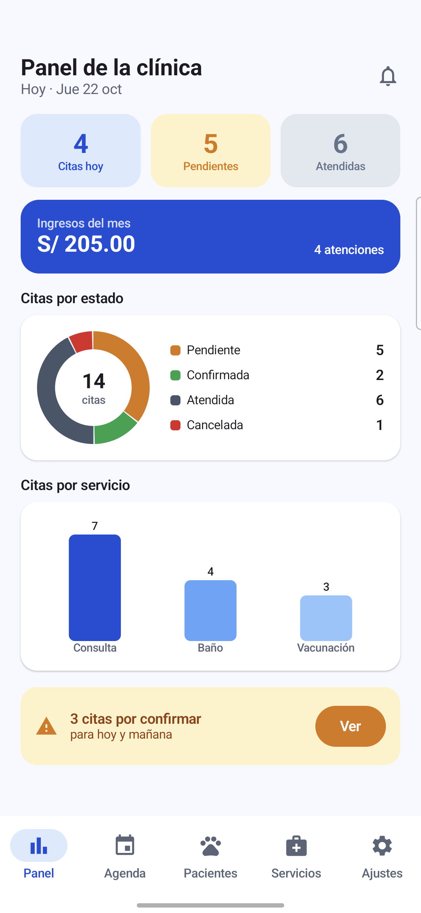 | 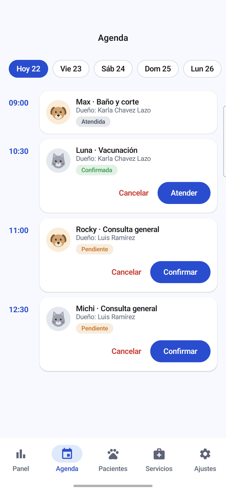 | 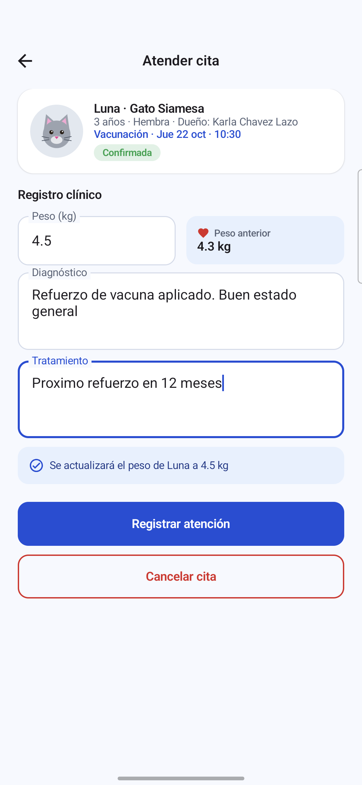 |

| Pacientes | Servicios | Nuevo servicio | Ajustes |
|---|---|---|---|
| 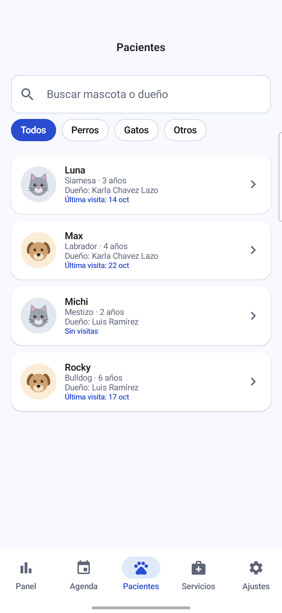 | 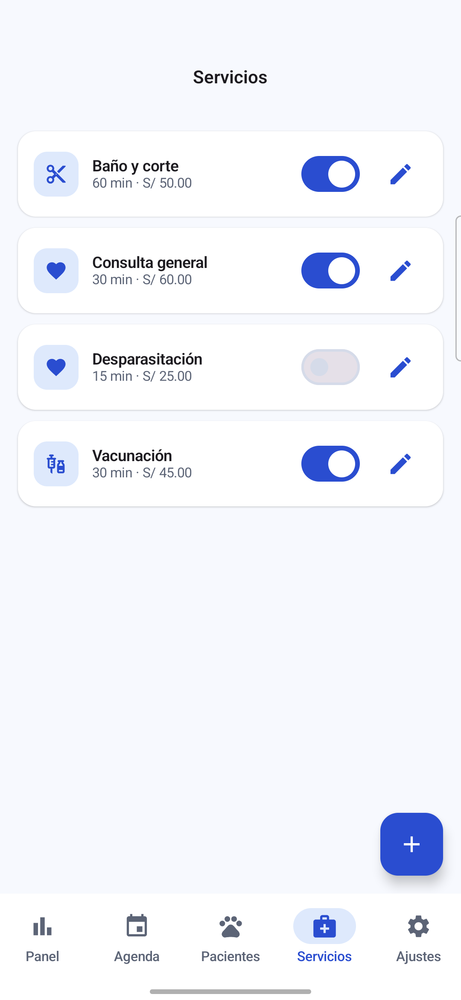 | 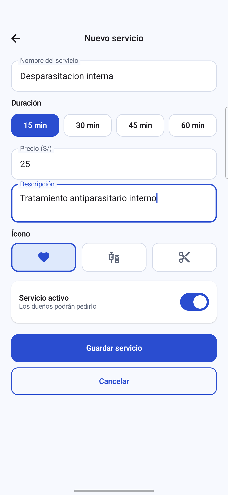 | 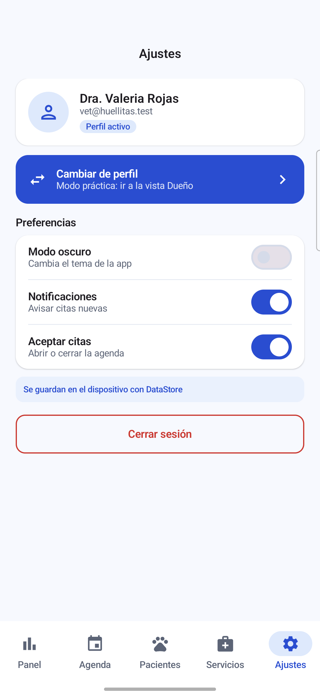 |

## Arquitectura MVVM

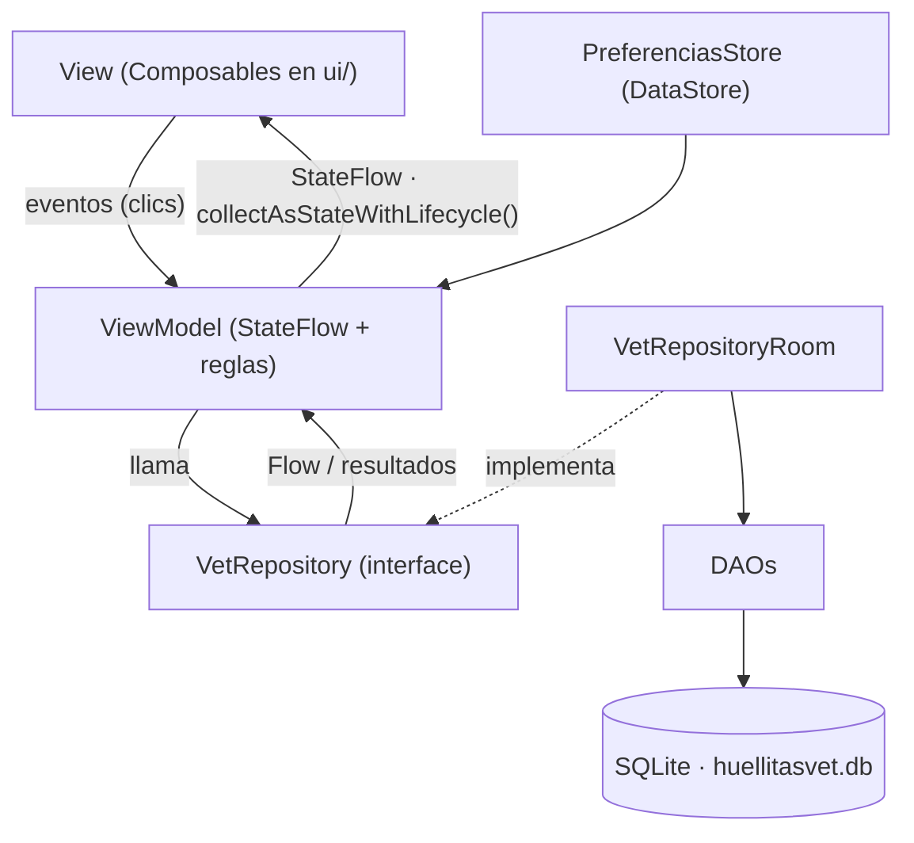

| Capa | Conoce a | No debe |
|---|---|---|
| View (`ui/`) | Solo a su ViewModel | Usar DAO, Repository ni reglas de negocio |
| ViewModel (`viewmodel/`) | Solo a la interface `VetRepository` (y `PreferenciasStore` para preferencias) | Conocer Composables ni DAOs |
| Repository (`data/repository/`) | Los DAOs (en `VetRepositoryRoom`) | Conocer pantallas ni ViewModels |
| DAO / Room (`data/local/`) | SQL y entidades | Conocer ViewModels |

- Lecturas que deben refrescar la pantalla: `Flow` (sin `suspend`). Escrituras o acciones únicas: `suspend`.
- Registrar una atención toca dos tablas (la cita y el peso de la mascota), por eso va dentro de `db.withTransaction { }`.
- `VetViewModelFactory` crea cada ViewModel pasándole el repository, así ninguna pantalla crea dependencias por su cuenta.
- DataStore guarda solo preferencias pequeñas: perfil activo, usuario, modo oscuro, notificaciones y aceptar citas.

## Estructura de paquetes

```
com.tecsup.huellitasvet
├── MainActivity.kt
├── VetApp.kt                        crea la base, el repository y las preferencias; siembra los datos
├── data
│   ├── local
│   │   ├── entity                   Servicio, Usuario, Mascota, Cita
│   │   ├── dao                      ServicioDao, UsuarioDao, MascotaDao, CitaDao
│   │   ├── relation                 MascotaConDueno, CitaConDetalle
│   │   ├── VetDatabase.kt           singleton de Room (huellitasvet.db)
│   │   └── DatosIniciales.kt        datos ficticios de la primera vez
│   ├── repository
│   │   ├── VetRepository.kt         interface (el contrato)
│   │   └── VetRepositoryRoom.kt     implementación con Room
│   └── prefs
│       └── PreferenciasStore.kt     DataStore
├── model                            Rol, EstadoCita, Especie, Sexo, ConteoServicio, Horarios, PuntoPeso
├── viewmodel                        VetViewModelFactory, Sesion, Inicio, Mascota, PedirCita, MisCitas,
│                                    Panel, Agenda, AtenderCita, Pacientes, Servicios, ReprogramarCita
└── ui
    ├── theme                        Color, Type, Theme (VetTheme por rol y modo oscuro)
    ├── components                   AppTopBar, VetButton, VetTextField, EstadoCitaChip, MascotaAvatar,
    │   │                            CitaCard, FechaChip, HoraChip, HistorialItem, IconoServicio, Formato
    │   └── graficos                 DatoGrafico, GraficoDona, GraficoBarras, GraficoLineas
    ├── navigation                   Rutas, NavVet (grafo del dueño y del veterinario)
    ├── dueno                        Splash, Login, Inicio, Mascotas, FormularioMascota, FichaMascota,
    │                                PedirCita, MisCitas, Perfil, ReprogramarCita
    └── veterinario                  Panel, Agenda, AtenderCita, Pacientes, Servicios,
                                     FormularioServicio, Ajustes
```

## Base de datos

### 1. Modelo conceptual

- Un usuario puede ser Dueño (CLIENTE) o Veterinario (ADMIN).
- Un dueño tiene muchas mascotas; cada mascota pertenece a un solo dueño.
- Una mascota tiene muchas citas; cada cita es de una sola mascota.
- Un servicio aparece en muchas citas; cada cita es de un solo servicio.
- Cuando una cita se atiende, guarda el diagnóstico, el tratamiento y el peso de ese día; con eso se arma el historial clínico.

### 2. Modelo entidad-relación (MER)

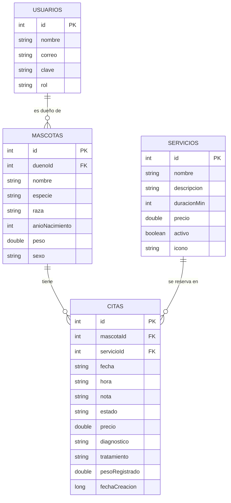

### 3. Modelo lógico

| Tabla | Columnas | Claves e índices |
|---|---|---|
| `usuarios` | id INTEGER, nombre TEXT, correo TEXT, clave TEXT, rol TEXT (CLIENTE o ADMIN) | PK `id` (autogenerada), índice único en `correo` |
| `servicios` | id INTEGER, nombre TEXT, descripcion TEXT, duracionMin INTEGER, precio REAL, activo INTEGER (0/1), icono TEXT (heart, syringe, scissors) | PK `id` |
| `mascotas` | id INTEGER, duenoId INTEGER, nombre TEXT, especie TEXT (PERRO, GATO, OTRO), raza TEXT, anioNacimiento INTEGER, peso REAL, sexo TEXT (MACHO, HEMBRA) | PK `id`, FK `duenoId` → `usuarios.id`, índice en `duenoId` |
| `citas` | id INTEGER, mascotaId INTEGER, servicioId INTEGER, fecha TEXT ('aaaa-MM-dd'), hora TEXT ('HH:mm'), nota TEXT, estado TEXT (PENDIENTE, CONFIRMADA, ATENDIDA, CANCELADA), precio REAL, diagnostico TEXT nulo, tratamiento TEXT nulo, pesoRegistrado REAL nulo, fechaCreacion INTEGER | PK `id`, FK `mascotaId` → `mascotas.id`, FK `servicioId` → `servicios.id`, índices en `mascotaId`, `servicioId` y `(fecha, hora)` |

Relaciones que arma Room:

- `MascotaConDueno`: la mascota (`@Embedded`) con su dueño (`@Relation`).
- `CitaConDetalle`: la cita (`@Embedded`) con su mascota y el dueño de la mascota (relación anidada con `entity = Mascota::class`) y con su servicio.

## Fase 2 · Mejoras con IA

Hechas en la rama `CON-IA` con ayuda de Claude. Los prompts, lo que generó la IA y lo que se corrigió están en [PROMPTS.md](PROMPTS.md).

| Mejora | Qué logra | Capas que cambian |
|---|---|---|
| Gráfico de peso de la mascota | La ficha muestra una línea con el peso registrado en cada atención | DAO + Repository + ViewModel + View |
| Reprogramar cita | El dueño cambia la fecha y la hora de una cita PENDIENTE o CONFIRMADA a un horario libre, hasta 2 horas antes | DAO + Repository + ViewModel + View |
| Búsqueda de pacientes | Busca por mascota, dueño o raza; filtra por especie y por "Con cita próxima"; ordena A-Z o por última visita | ViewModel + View |

| Gráfico de peso | Mis citas con reprogramar | Reprogramar cita | Búsqueda de pacientes |
|---|---|---|---|
|  |  |  |  |

### Cambios en la base de datos

Ninguna mejora cambió ni agregó entidades: no hay columnas nuevas, la base sigue en `version = 1` y no hizo falta una `Migration`. Solo se agregaron consultas al `CitaDao`, declaradas primero en la interface `VetRepository`:

| Función | Tipo | Qué hace |
|---|---|---|
| `observarPesos(mascotaId)` | `Flow<List<PuntoPeso>>` | `SELECT fecha, pesoRegistrado` de las citas ATENDIDAS de la mascota, ordenadas por fecha y hora |
| `reprogramarCita(id, fecha, hora)` | `suspend` | `UPDATE` de fecha y hora; la cita vuelve a PENDIENTE y conserva su precio |

### Reglas nuevas

| Regla | Dónde vive |
|---|---|
| El gráfico de peso aparece con al menos 2 atenciones con peso; con menos se muestra un aviso | `MascotaViewModel.pesos()` y `FichaMascotaScreen` |
| Solo se reprograma una cita PENDIENTE o CONFIRMADA y si faltan más de 2 horas | `ReprogramarCitaViewModel.puedeReprogramar()` y `MisCitasViewModel.puedeReprogramar()` |
| La nueva hora debe estar libre y en el futuro; antes de guardar se vuelve a consultar el horario | `ReprogramarCitaViewModel.confirmar()` |
| Una cita reprogramada vuelve a PENDIENTE para que el veterinario confirme el nuevo horario | `CitaDao.reprogramar()` |
| "Con cita próxima" muestra solo mascotas con una cita PENDIENTE o CONFIRMADA desde ahora | `PacientesViewModel` |
| Al ordenar por última visita, las mascotas sin visitas quedan al final | `PacientesViewModel` |

### Pruebas de la Fase 2

| Prueba | Resultado esperado | Estado |
|---|---|---|
| Ficha de Luna, Historial clínico | Línea con 4.0, 4.2 y 4.3 kg en sus fechas | Cumple |
| Ficha de Rocky (un solo peso) | Aviso de que se necesitan 2 atenciones | Cumple |
| Reprogramar una cita a un horario libre | Cambia fecha y hora, queda PENDIENTE y mantiene el precio | Cumple |
| Reprogramar y elegir un horario ocupado | El horario aparece gris y no se puede elegir | Cumple |
| Reprogramar una cita a menos de 2 horas | No se permite y se muestra un mensaje | Cumple |
| Buscar "bull" en Pacientes | Aparece solo Rocky (raza Bulldog) | Cumple |
| Filtro "Con cita próxima" | Solo las mascotas con una cita próxima | Cumple |
| Ordenar por última visita | La visita más reciente primero y las mascotas sin visitas al final | Cumple |
| Limpiar filtros | Vuelven todos los pacientes | Cumple |

## Para pensar

¿Por qué fecha y hora son texto?

Porque con el formato aaaa-MM-dd y HH:mm el texto se ordena igual que una fecha de verdad, se puede comparar directo en SQL con = o >= y en Kotlin se convierte fácil con LocalDate.parse y LocalTime.parse. Así Room guarda las fechas sin necesitar convertidores de tipos.

¿Por qué guardar el precio en la cita?

Porque el precio que se guarda es el que tenía el servicio cuando se pidió la cita, como una foto de ese momento. Si después la clínica cambia el precio de un servicio, las citas que ya existen mantienen lo que costaron y los ingresos del panel no se alteran.

¿Esta función cambia datos una sola vez o debe avisar cuando cambian?

Si la función solo guarda o cambia algo una vez, como crear una cita, cancelarla o registrar una atención, es suspend. Si la pantalla tiene que enterarse cada vez que los datos cambian, como la lista de citas o los contadores del panel, devuelve un Flow. Las dos se complementan: cuando el veterinario confirma una cita con una función suspend, el Flow de Mis citas avisa y la pantalla del dueño se actualiza sola.
