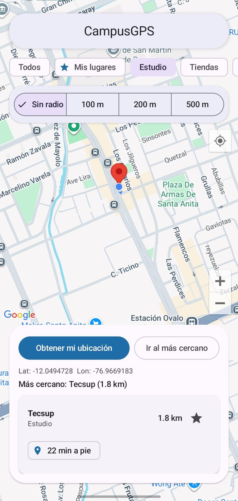
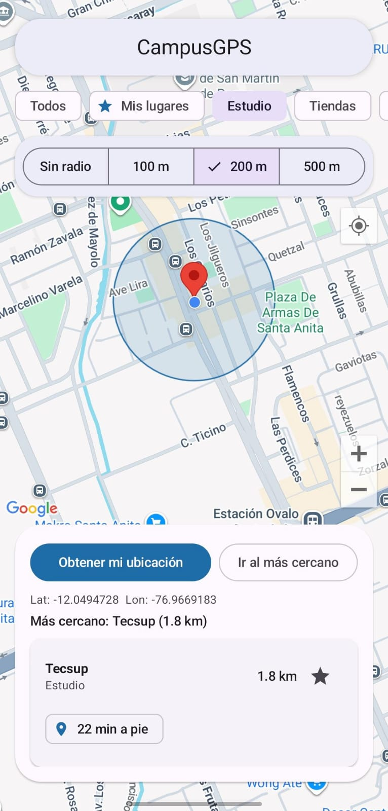
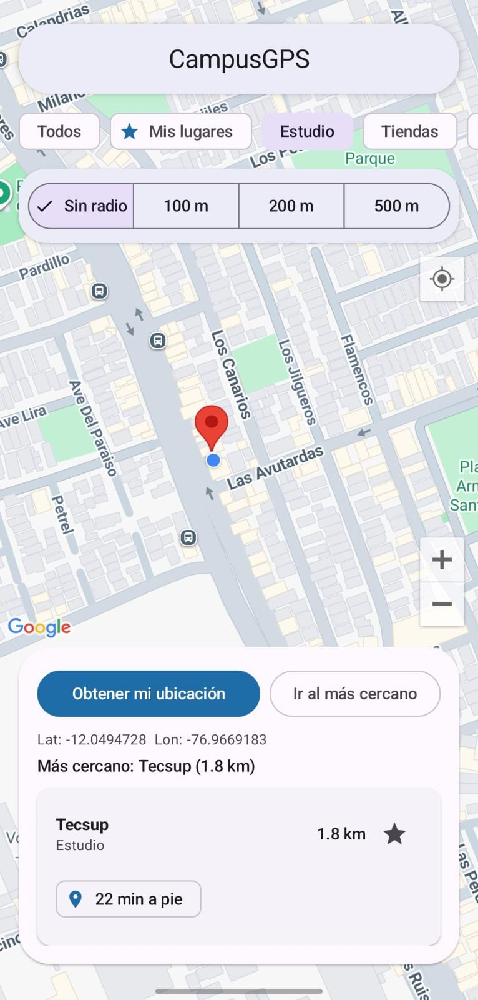
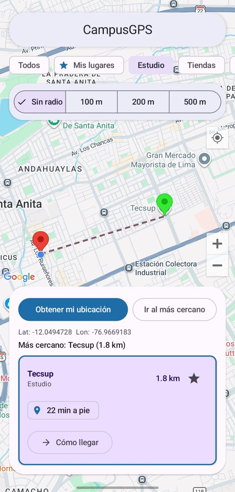
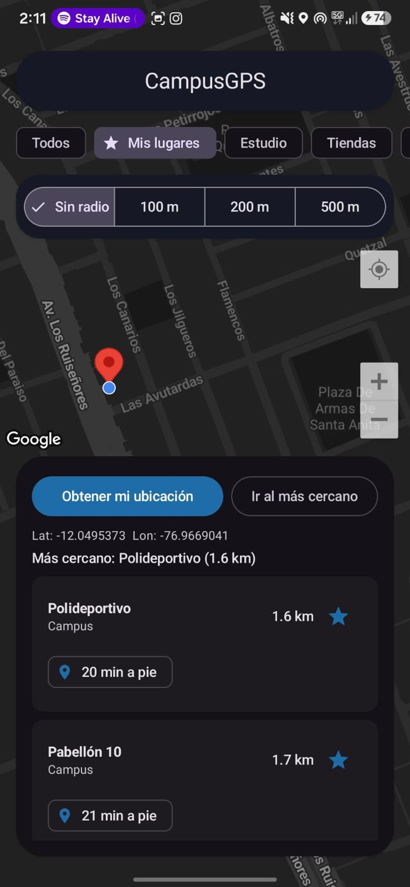

# CampusGPS - Fase 2

App Android que muestra tu ubicación en un mapa y los lugares del campus ordenados por cercanía.
En la Fase 2 se amplió con filtros, radio, guía a pie y favoritos persistentes.

## Mejoras

1. **Filtrar por categoría:** chips (Todos, Estudio, Comida, Eventos, Servicios) que filtran el mapa, la lista y el "más cercano".
2. **Radio de cercanía:** selector de 100, 200 o 500 m; dibuja un círculo en el mapa y marca los lugares "Dentro del radio".
3. **Punto azul nativo:** ubicación del sistema y botón de mi ubicación, solo si el permiso fue concedido.
4. **"Guíame hasta allá":** línea punteada recta al lugar elegido, "X min a pie" y botón "Cómo llegar" que abre Google Maps.
5. **Favoritos y "Mis lugares":** estrella en cada tarjeta, guardada con DataStore, y chip para ver solo los favoritos.

## Capturas

| Mejora 1 | Mejora 2 | Mejora 3 |
|---|---|---|
|  |  |  |

| Mejora 4 | Mejora 5 |
|---|---|
|  |  |

## Arquitectura

MVVM + Repository con interfaces: la View solo habla con su `MapaViewModel`, el ViewModel solo con las interfaces de Repository (sin Context), y los cálculos (distancia, radio, minutos a pie) están en `util/` o en el ViewModel. Los componentes nuevos están en `ui/components/` y no conocen el ViewModel.
