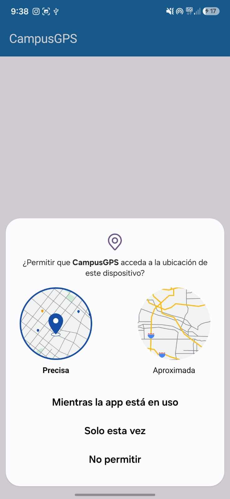
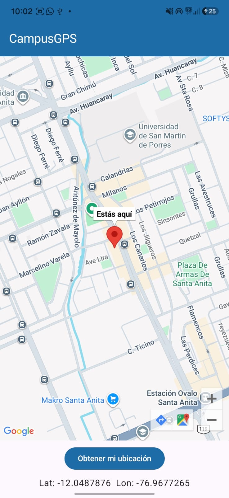
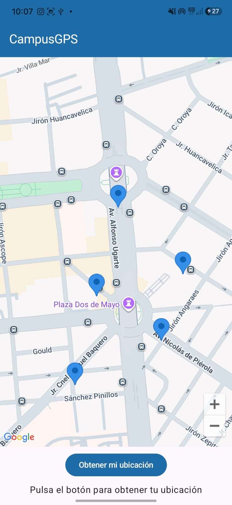
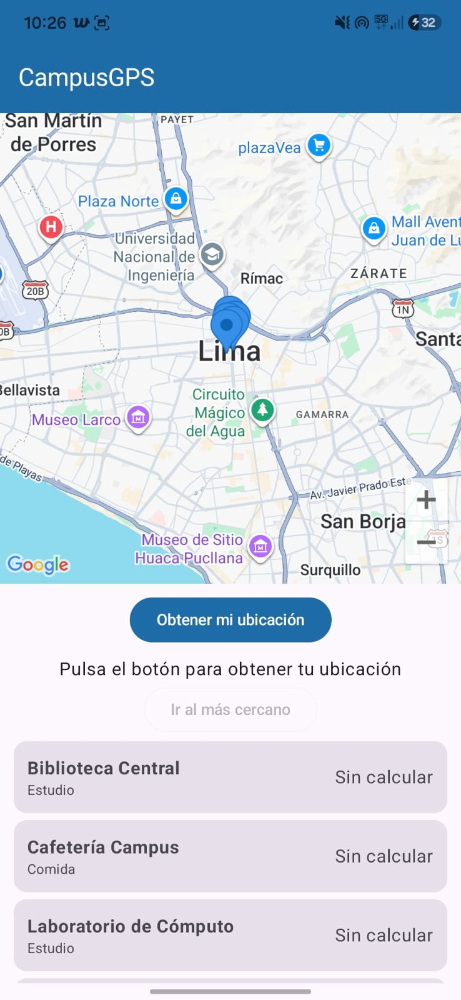
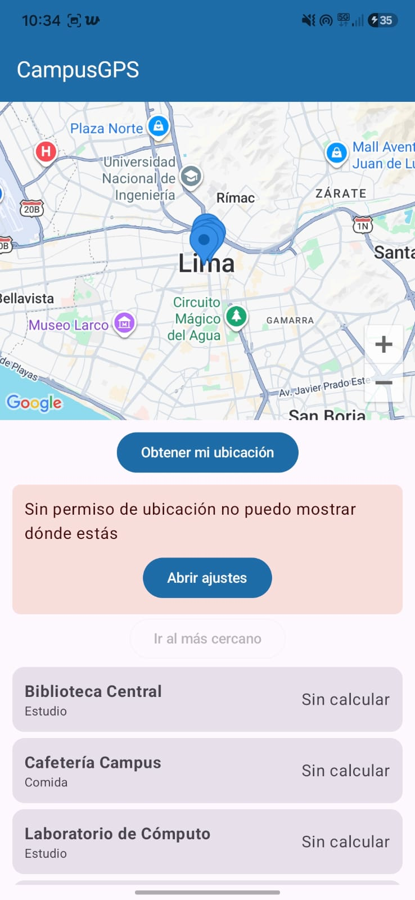

# CampusGPS

App Android que obtiene la ubicación del celular, la muestra en un mapa y dice qué lugar del campus está más cerca. Muestra cinco puntos ficticios (biblioteca, cafetería, laboratorio, auditorio y estacionamiento) con su distancia en metros, ordenados del más cercano al más lejano.

- **Tecnología:** Kotlin + Jetpack Compose + Material 3 (sin XML), Google Play Services Location, Maps Compose.
- **Patrón:** MVVM + Repository (con interfaces).
- **Curso:** Programación en Móviles, Laboratorio 13 (Localización Geográfica).

## Estructura de paquetes

```
com.chavez.campusgps/
├── MainActivity.kt
├── model/
│   └── Modelos.kt                  Posicion, Lugar, LugarConDistancia, TipoError, UbicacionUi
├── data/
│   ├── UbicacionRepository.kt      interface (+ UbicacionNoDisponibleException)
│   ├── UbicacionRepositoryGoogle.kt  implementación con FusedLocationProviderClient
│   ├── LugaresRepository.kt        interface
│   └── LugaresRepositoryLocal.kt   los 5 lugares fijos
├── util/
│   ├── Distancia.kt                distanciaMetros(...)
│   └── Formato.kt                  formatearDistancia(...)
├── viewmodel/
│   ├── MapaViewModel.kt
│   └── CampusViewModelFactory.kt
└── ui/
    ├── PantallaMapa.kt
    ├── MapaUbicacion.kt
    ├── ListaLugares.kt
    ├── MensajeError.kt
    └── theme/
```

## Arquitectura MVVM + Repository

```
View (PantallaMapa)
   | evento: pulsar el botón        ^ collectAsState()
   v                                |
ViewModel (MapaViewModel) --- StateFlow --->
   | llama a las interfaces
   v
UbicacionRepository --> UbicacionRepositoryGoogle (FusedLocationProviderClient)
LugaresRepository   --> LugaresRepositoryLocal (los 5 lugares fijos)
```

- La **View** solo habla con su ViewModel y dibuja según el estado.
- El **ViewModel** solo conoce las interfaces de Repository y no recibe Context. Calcula las distancias usando funciones puras de `util/`.
- El **Repository** es el único que conoce Google Play Services.

## Capturas

| Permiso | Mapa con tu ubicación | Marcadores |
|---|---|---|
|  |  |  |

| Lista ordenada | Error |
|---|---|
|  |  |

## Para pensar

**1. ¿Por qué FusedLocationProviderClient está dentro del Repository y no en el ViewModel?**
Porque el ViewModel no debe conocer detalles de Android ni de Google Play Services ni recibir un Context. Si la ubicación sale de un Repository con una interface, el ViewModel solo pide "dame la posición". 

**2. ¿Qué diferencia hay entre el permiso de ubicación y la clave de API de Maps? ¿Qué pasa si falta cada uno?**
El permiso lo concede el usuario y autoriza a la app a leer dónde está el celular. La clave de API identifica a la app ante Google para poder descargar y dibujar el mapa. Si falta el permiso, no hay latitud ni longitud y la app muestra el mensaje de error con "Abrir ajustes", pero el mapa se ve. Si falta la clave, la ubicación funciona, pero el mapa sale gris o en blanco.

**3. ¿Por qué la clave va en `local.properties` y no en el código? ¿Qué harías si se subiera a GitHub por error?**
Porque el código se sube a GitHub y cualquiera podría copiar y usar la clave a mi costo. `local.properties` está en `.gitignore` y Gradle la inyecta al Manifest al compilar. Si se subiera, la borraría de Google Cloud, crearía una clave nueva con restricción de paquete y SHA-1, y limpiaría el repositorio y su historial.

**4. ¿Dónde calculas la distancia y por qué no en el Composable?**
En el ViewModel (`actualizarDistancias`), usando la función pura `distanciaMetros` de `util/`. Un Composable se redibuja muchas veces: si calculara ahí, repetiría el trabajo, mezclaría lógica con interfaz y sería difícil de probar. La pantalla solo recibe la lista ya calculada y ordenada.

**5. ¿Qué pasa con tu app si el usuario niega el permiso dos veces? ¿Cómo lo manejas?**
Android deja de mostrar el cuadro de permiso y la solicitud se resuelve sola como negada. La app no se cierra: el ViewModel recibe `permisoDenegado()` y muestra el mensaje de error con el botón "Abrir ajustes", que lleva a la pantalla de la app para que el usuario active el permiso manualmente.
