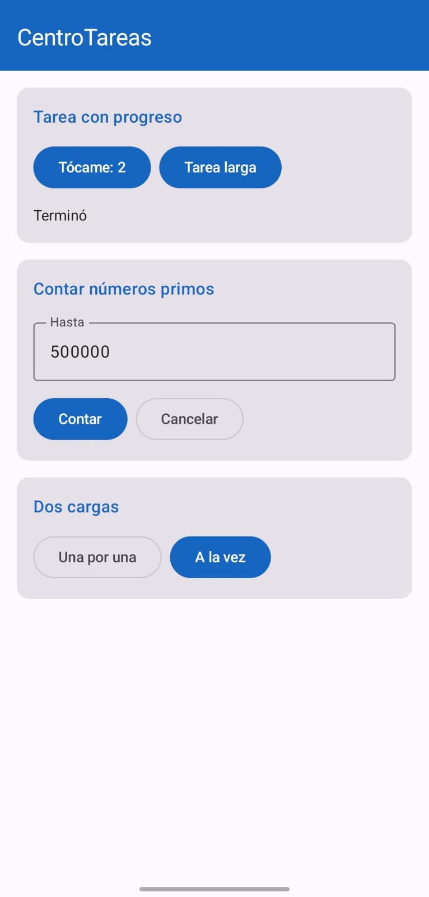
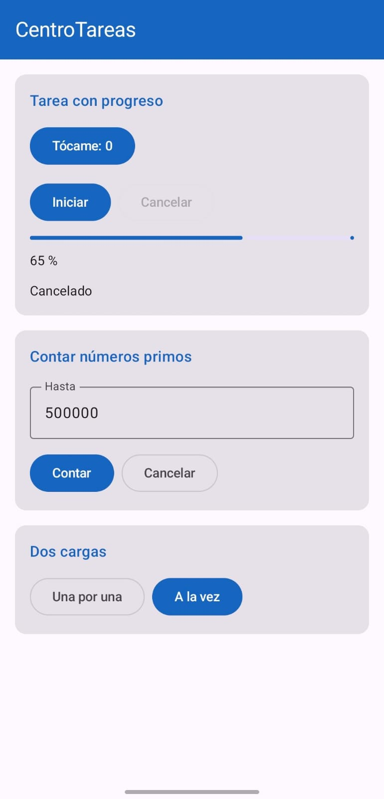
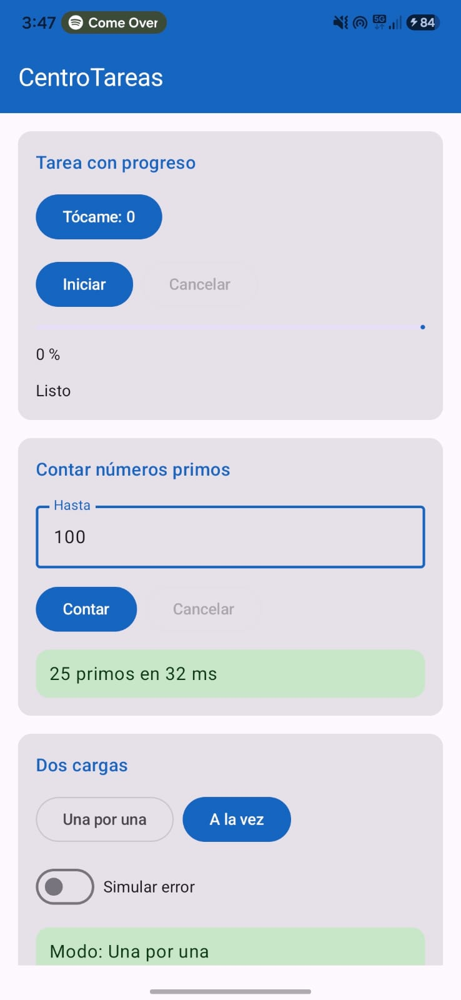
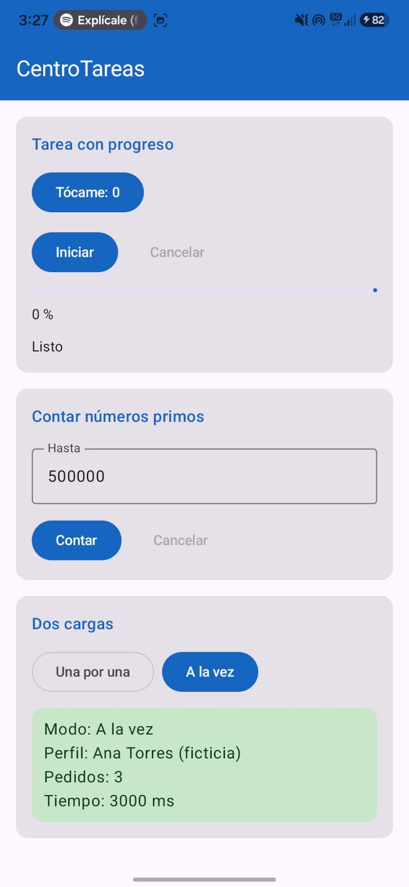
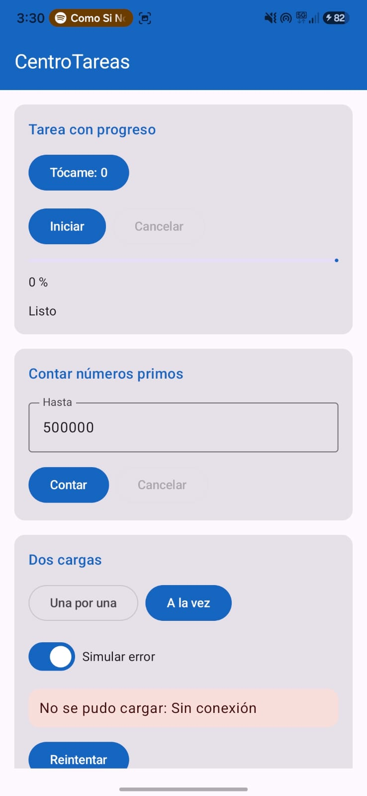

# CentroTareas

App Android (Kotlin + Jetpack Compose + Material 3) del Laboratorio 14 "Hilos en Android". Muestra cómo hacer tareas largas sin congelar la pantalla, usando corrutinas, `ViewModel` y el patrón MVVM + Repository (con interface).

## Descripción

CentroTareas hace tres cosas que tardan:

1. **Tarea con progreso**: una tarea de ~4 s con barra de progreso, que se puede cancelar.
2. **Contar números primos**: un cálculo pesado en segundo plano, cancelable.
3. **Dos cargas**: carga simulada de perfil y pedidos, "Una por una" contra "A la vez" (`async`), con error simulado y reintento.

Todos los datos son ficticios; no usa permisos ni internet (las cargas se simulan con `delay`).

## Árbol de paquetes

```
com.chavez.centrotareas
├── MainActivity.kt
├── model
│   └── Estados.kt                 (PrimosUi, CargaUi)
├── data
│   ├── TareasRepository.kt        (interface)
│   └── TareasRepositoryLocal.kt   (cargas simuladas y contarPrimos)
├── viewmodel
│   ├── TareasViewModel.kt
│   └── TareasViewModelFactory.kt
└── ui
    ├── PantallaTareas.kt
    └── theme
        ├── Color.kt
        ├── Theme.kt
        └── Type.kt
```

| Capa | Conoce a | No debe |
|------|----------|---------|
| View (`ui/`) | Solo a su ViewModel | Lanzar corrutinas ni usar Thread |
| ViewModel | Solo a la interface del Repository | Conocer Composables, recibir un Context ni bloquear el hilo principal |
| Repository | Nada de la UI | Exponer estados de pantalla; sus funciones `suspend` no bloquean el hilo |

## Observación del Paso 1

Al tocar **Tarea larga (MAL)**, la pantalla se congela durante 4 segundos: el botón **Tócame** deja de sumar y no responde ningún toque. El texto `Trabajando...` nunca llega a verse, porque `Thread.sleep(4000)` se ejecuta en el hilo principal, que es el mismo que dibuja la pantalla. Mientras está dormido no puede redibujar, así que cuando por fin se libera, el mensaje ya cambió a `Terminó` y solo se dibuja ese último valor.

Si la espera fuera de 10 segundos, Android mostraría el diálogo **"La aplicación no responde" (ANR, Application Not Responding)**, con las opciones de cerrar la app o esperar. Android lo muestra cuando el hilo principal no atiende un toque en unos 5 segundos.

### Capturas

| Tarea con progreso | Tarea cancelada | Contar números primos |
|:---:|:---:|:---:|
|  |  |  |

| Una por una | A la vez | Error simulado |
|:---:|:---:|:---:|
|  |  |  |


## Para pensar

**1. ¿Por qué no se veía `Trabajando...` en el Paso 1?**

Porque `Thread.sleep(4000)` bloqueaba el hilo principal, que es el encargado de dibujar la pantalla. El mensaje se cambió a `Trabajando...`, pero la interfaz no pudo redibujarse hasta que terminó la espera; para entonces el mensaje ya era `Terminó`.

**2. ¿Qué diferencia hay entre `Thread.sleep` y `delay`?**

`Thread.sleep` bloquea el hilo donde se ejecuta: ese hilo no puede hacer nada más mientras duerme, y no se puede cancelar de forma cooperativa. `delay` es una función `suspend` que suspende la corrutina sin bloquear ningún hilo: el hilo queda libre para hacer otro trabajo y, además, `delay` revisa la cancelación, así que la corrutina se puede cancelar mientras espera.

**3. ¿Por qué `Dispatchers.Default` para los primos y `Dispatchers.IO` para la red?**

`Dispatchers.Default` tiene un número de hilos parecido al de núcleos del procesador, ideal para trabajo que consume CPU (como contar primos): más hilos que núcleos no lo harían más rápido. `Dispatchers.IO` usa un grupo de hilos mucho más grande, pensado para operaciones que pasan la mayor parte del tiempo esperando (red, disco): muchos hilos pueden estar esperando a la vez sin ocupar el procesador.

**4. ¿Qué pasaría con la corrutina si el usuario cierra la pantalla? ¿Qué papel cumple `viewModelScope`?**

`viewModelScope` está atado al ciclo de vida del ViewModel: cuando el ViewModel se destruye (el usuario cierra la pantalla definitivamente), todas las corrutinas lanzadas en ese scope se cancelan automáticamente, así no quedan trabajando en vano ni se filtra memoria. En una rotación de pantalla el ViewModel sobrevive, así que la tarea continúa y el progreso no se reinicia.

**5. ¿Por qué `async` tarda 3 s y no 5 s? ¿Qué pasa si una de las dos cargas falla?**

Con `async` las dos cargas se lanzan al mismo tiempo, así que el tiempo total es el de la más lenta. Una por una se suman: 2 s + 3 s = 5 s. Si una de las dos falla, el `coroutineScope` cancela a la otra y relanza la excepción, que llega al `try/catch` del ViewModel y deja la pantalla en estado de error con el botón Reintentar.