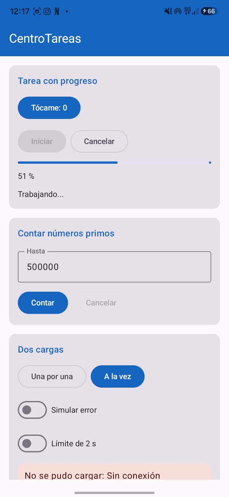
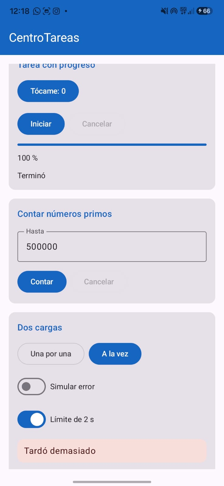
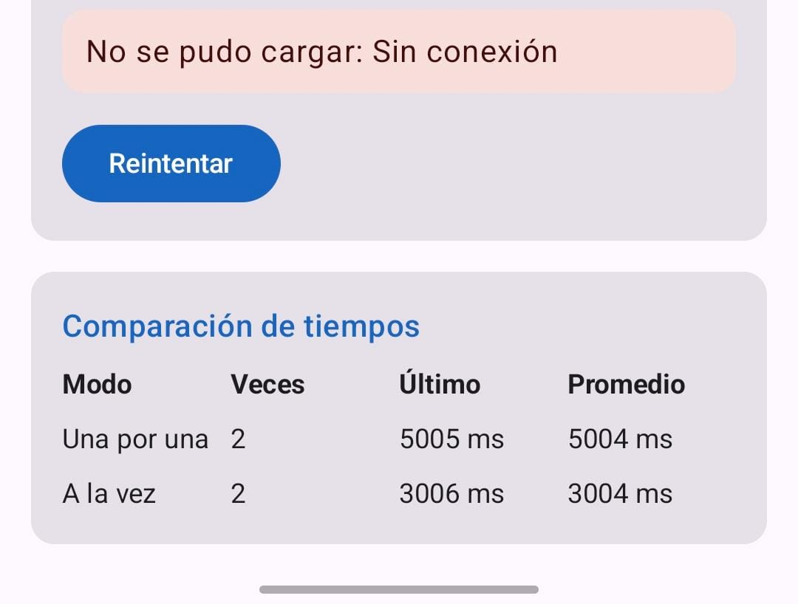
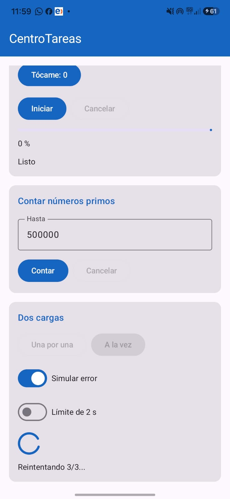

# CentroTareas - Fase 2

App Android (Kotlin + Jetpack Compose + Material 3) con tareas largas en segundo plano usando corrutinas.
En esta fase, hecha con ayuda de IA, se agregan 4 mejoras sin romper la arquitectura MVVM + Repository.

## Mejoras

1. **Progreso desde el Repository**: la tarea simulada ahora es un `Flow<Float>` con `flowOn(Dispatchers.Default)`.
2. **Tiempo máximo**: el interruptor "Límite de 2 s" envuelve las cargas en `withTimeout` y muestra "Tardó demasiado".
3. **Reintento automático**: hasta 3 reintentos con espera de 1, 2 y 4 s, con aviso "Reintentando n/3...".
4. **Comparación de tiempos**: tabla con cantidad, último y promedio de "Una por una" y "A la vez".

## Capturas

| Mejora 1 | Mejora 2 | Mejora 3 | Mejora 4 |
|:---:|:---:|:---:|:---:|
|  |  |  |  |

## Arquitectura

La View solo habla con `TareasViewModel`; el ViewModel solo con la interface `TareasRepository`; el Repository no expone estados de pantalla. Los componentes nuevos están en `ui/components/` y no conocen el ViewModel. No hay `GlobalScope`, `runBlocking` ni `Thread.sleep`, y la `CancellationException` siempre se relanza.
